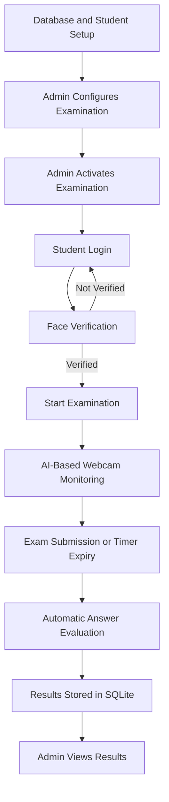

# 🎓 Online Exam System with AI Proctoring

A full-stack web-based **Online Examination System** developed using Python (Flask) and SQLite, featuring AI-assisted proctoring using **YOLOv3-tiny**, OpenCV, and face verification to support secure and reliable online examinations.

## ✨ Key Features

### 👨‍💼 Admin Portal
- **Dashboard & Analytics:** Monitor registered students, active exams, and overall examination status.
- **Student Management:** Add students individually or import student records in bulk using CSV files.
- **Student Verification:** Manage student profiles and verify faces before examinations.
- **Subject Management:** Create and manage examination subjects.
- **Question Bank Management:** Add and manage multiple-choice questions.
- **Live Exam Control:** Start, pause, or end active examination sessions.
- **Result Management:** View automatically evaluated examination results.

### 👨‍🎓 Student Portal
- **Student Login:** Secure access to the examination portal.
- **Face Verification:** Verify student identity before entering the examination.
- **AI-Proctored Examination:** Webcam-based monitoring using YOLOv3-tiny and face-detection models.
- **Object Detection:** Identify supported objects, including mobile phones, and detect multiple people where supported by the configured models.
- **Timed Examination:** Attempt questions within the allocated examination duration.
- **Automatic Submission:** Submit answers automatically when the examination timer expires.
- **Automated Evaluation:** Calculate examination results and store them in the database.

## 🛠️ Technology Stack

| Category | Technologies |
|---|---|
| Backend | Python 3, Flask |
| Database | SQLite |
| Frontend | HTML5, CSS3, JavaScript |
| Template Engine | Jinja2 |
| Computer Vision | OpenCV |
| Object Detection | YOLOv3-tiny |
| Face Verification | Face Detection and Recognition Models |

## 📁 Project Structure

```text
Online_Exam_system/
│
├── app.py                     # Main Flask application
├── setup_database.py          # Database initialization
├── add_students.py            # Student registration script
├── student.csv                # Student data for bulk import
├── college_exam_database.db   # SQLite database
├── active_exams.json          # Active examination sessions
├── exam_status.json           # Examination status
├── requirements.txt           # Python dependencies
│
├── static/
│   ├── CSS files
│   ├── JavaScript files
│   ├── Images
│   └── Face detection models
│
├── templates/                 # Admin and Student HTML templates
│
├── uploads/                   # Uploaded student photos and assets
│
└── yolo_model/
    ├── yolov3-tiny.cfg         # YOLO configuration
    ├── yolov3-tiny.weights     # Pre-trained YOLO weights
    └── coco.names             # Object class labels
```

## 🔄 System Workflow



### Step-by-Step Execution

1. **Database Initialization:** The `setup_database.py` script creates the required database tables for students, administrators, subjects, questions, and examination results.

2. **Student Registration:** Administrators can register students individually or import student details using `student.csv` and `add_students.py`.

3. **Examination Configuration:** Administrators create subjects, add questions, and configure examination sessions.

4. **Exam Activation:** The administrator activates the examination session using the exam-status management functionality.

5. **Student Authentication:** Students log in and complete face verification using their registered profile photos.

6. **AI-Proctored Examination:** After successful verification, students enter the examination interface. The webcam and configured computer-vision models monitor the examination environment.

7. **Exam Submission:** Students can submit their answers manually or the system submits them when the timer expires.

8. **Automated Evaluation:** The application evaluates submitted answers and stores the results in the SQLite database.

9. **Result Management:** Administrators can access and review student examination results through the Admin dashboard.

## 🚀 Installation and Setup

### 1. Clone the Repository

```bash
git clone https://github.com/shreyavekhande/Online_Exam_system.git
```

Navigate to the project directory:

```bash
cd Online_Exam_system
```

### 2. Create a Virtual Environment

```bash
python -m venv venv
```

Activate the virtual environment.

**Windows:**

```bash
venv\Scripts\activate
```

**Linux / macOS:**

```bash
source venv/bin/activate
```

### 3. Install Dependencies

```bash
pip install -r requirements.txt
```

### 4. Initialize the Database

```bash
python setup_database.py
```

To add student records using the provided script:

```bash
python add_students.py
```

### 5. Run the Application

```bash
python app.py
```

### 6. Open in Browser

Open your browser and visit:

```text
http://127.0.0.1:5000
```

The Online Exam System is now ready to run locally.

## 🤖 AI Proctoring Module

The system integrates computer-vision techniques to support examination monitoring.

### YOLOv3-tiny
- A lightweight object-detection model.
- Used to identify supported objects in webcam frames.
- Helps monitor selected prohibited objects, such as mobile phones, depending on the configured model classes.

### OpenCV
- Used for image and video processing.
- Supports webcam access and frame processing.
- Works with the configured detection models.

### Face Verification
- Checks the student's face against the registered reference photo.
- Supports identity verification before examination entry.

**Note:** AI-based detection is not 100% accurate. Results depend on lighting, camera quality, model configuration, and environmental conditions. Detection alerts should be reviewed and should not be treated as conclusive proof of misconduct.

## 🗄️ Database

The project uses **SQLite** for storing examination-related information.

Database file:

```text
college_exam_database.db
```

The database manages application records such as:
- Student information
- Administrator information
- Subjects
- Examination questions
- Student examination results

## 🔮 Future Enhancements

- Improve AI-based suspicious activity detection.
- Add detailed examination analytics and reports.
- Implement enhanced student authentication.
- Add automated examination report generation.
- Improve the Admin dashboard and user interface.
- Deploy the application to a secure cloud platform.

## 👩‍💻 Author

**Shreya Vekhande**

GitHub: [@shreyavekhande](https://github.com/shreyavekhande)

---

⭐ If you find this project interesting, consider giving the repository a star!

**Online Exam System with AI Proctoring — Making Online Examinations Smarter and More Efficient.**
